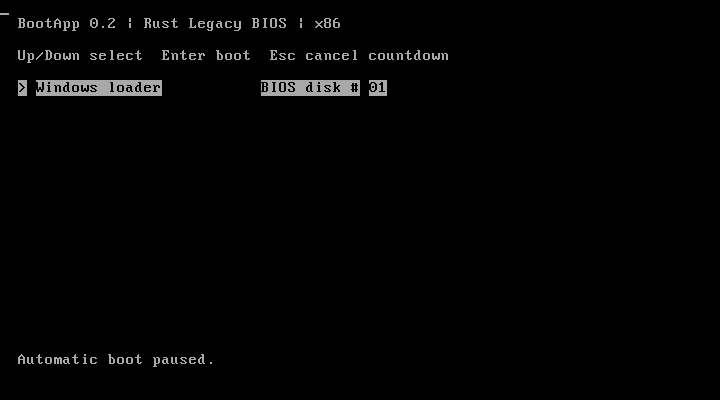
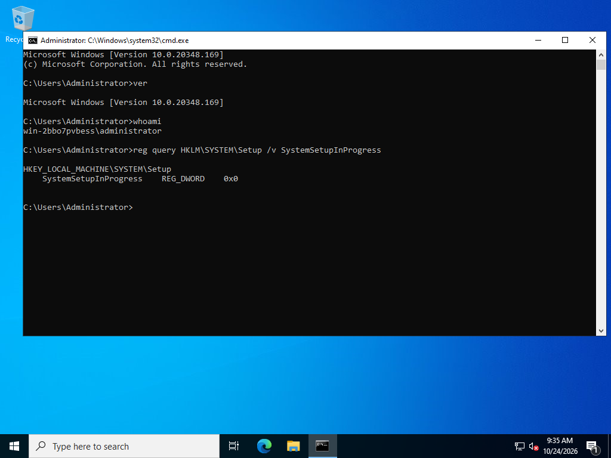
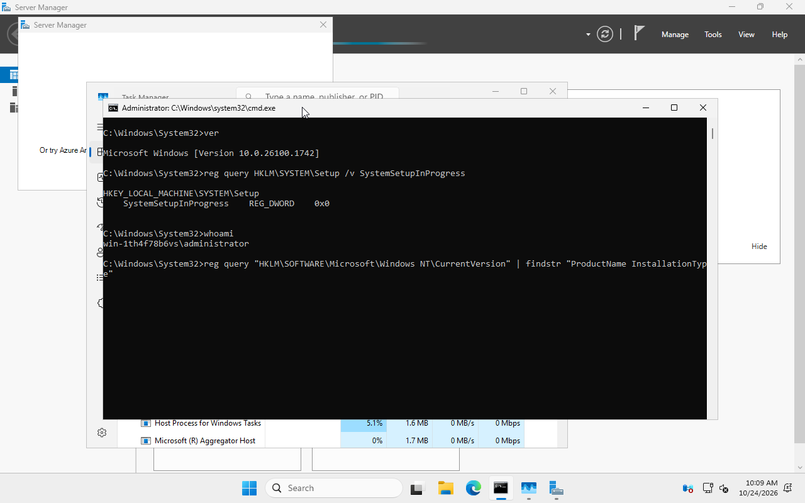

# Validation — v0.2.0

Tests ran on Windows with Rust 1.99.0, uefi 0.41.0, NASM 3.02 and QEMU 11.1 TCG.
Guest tests use x64 installed operating systems from official images. This is
real OS execution on virtual hardware, not physical-machine certification.

| Check | Result |
|---|---|
| Core config/menu/path/detection | PASS — 18 tests |
| Host CLI, mounted scan and reparse handling | PASS — 9 tests |
| Firmware volume/self policy | PASS — 2 tests |
| BIOS midnight counter regression | PASS — 3 tests |
| Formatting and warnings-denied Clippy | PASS |
| IA32/X64/AArch64 UEFI release build and EFI fixture execution | PASS |
| BIOS auto boot, timeout cancellation, empty disk fixtures | PASS |
| Cross-volume discovery and selected-volume execution | PASS — 7 fixture selections |
| Debian 13.7 / kernel 6.12.113, BIOS | PASS — systemd running, SSH and guest-side OS identity |
| Debian 13.7 / kernel 6.12.113, UEFI | PASS — same userspace proof and UEFI firmware identity |
| Windows Server 2022 Evaluation, BIOS | PASS — normal OOBE, local login, Explorer desktop, ver 10.0.20348.169, SetupInProgress=0, normal shutdown |
| Windows Server 2025 Evaluation, UEFI | PASS — normal OOBE, local login, Explorer desktop, ver 10.0.26100.1742, SetupInProgress=0; USB input/private guest NVRAM lab configuration |
| macOS actual OS boot / APFS driver | NOT_RUN — path fixtures only; firmware-visible storage required |
| Physical hardware / Secure Boot | NOT_RUN |
| Hosted CI | NOT_RUN |

There are 32 distinct unit/regression tests. EFI path fixtures deliberately use
test applications and are not counted as actual Windows/Linux/macOS OS boots.
Windows registry observations distinguish an installed Server system from WinPE.

## Captured examples







## Reproduce

```powershell
cargo test --locked --workspace
cargo clippy --locked --workspace --all-targets -- -D warnings
cargo clippy --manifest-path crates/bootapp-bios/Cargo.toml --target i686-unknown-linux-gnu -- -D warnings
rustc --edition=2024 --test crates/bootapp-bios/src/timer.rs -o bios-timer-tests.exe
.\bios-timer-tests.exe
.\scripts\build.ps1
python scripts/build-bios.py --nasm C:/path/to/nasm.exe --output out/bios
python scripts/test-bios.py --qemu-dir C:/path/to/qemu --nasm C:/path/to/nasm.exe --image out/bios/bootapp-bios.img --case auto
python scripts/test-autodiscovery.py --qemu-dir C:/path/to/qemu --project-root .
python scripts/os-lab.py --help
```

For modern Windows UEFI VM input, the OS lab supports `--usb-input` (xHCI,
USB keyboard/tablet) and `--persistent-vars` (a private guest NVRAM file).
No host firmware setting is changed. The runner records launch as NOT_RUN;
OS boot success still requires guest-side/visual evidence.

Images: [Debian cloud](https://cloud.debian.org/images/cloud/trixie/latest/),
[Windows Server 2022 evaluation](https://www.microsoft.com/en-us/evalcenter/download-windows-server-2022),
[Windows Server 2025 evaluation](https://www.microsoft.com/en-us/evalcenter/download-windows-server-2025).
Operating-system images, credentials and machine-specific lab logs are not
included in this repository. Use your own dedicated copies/overlays.

## Findings fixed

Independent firmware review found a BIOS midnight tick-counter issue; the daily
modulus fix has targeted regression tests. Actual mounted-directory acceptance
found missing Preboot/Recovery roots in the host scan; a failing regression test
and seven-candidate scan verify the fix. No repeated broad-review loop was used.
