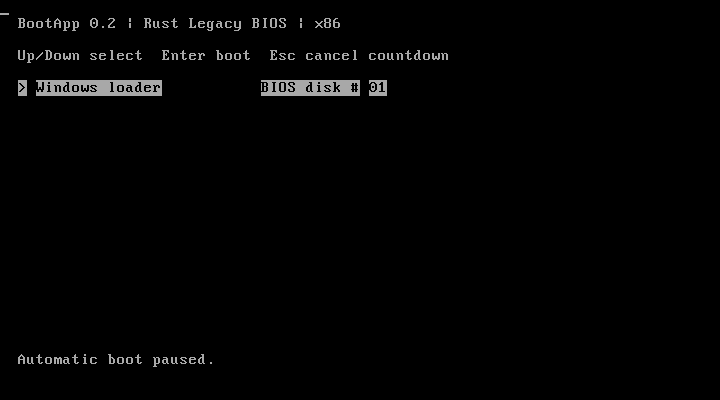
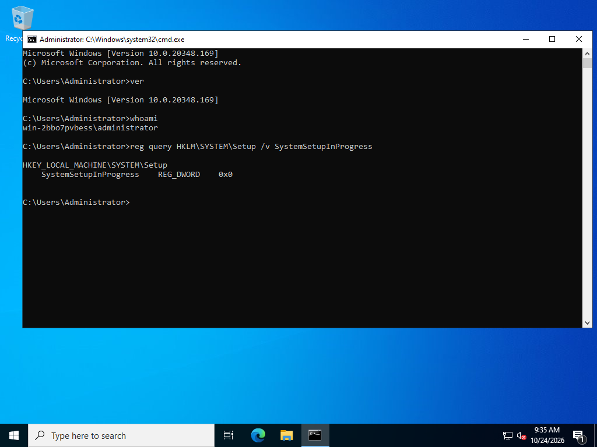
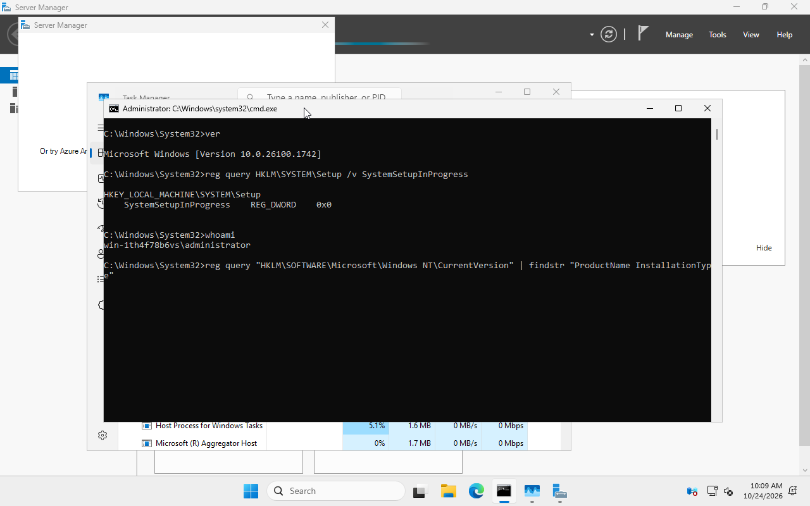

# Validation — v0.3.0 (unreleased)

Environment for the v0.3 runs: Windows host, Rust 1.99.0 (UEFI targets i686, x86_64, aarch64),
`uefi` 0.41.0, NASM 3.02, QEMU 11.1 with TCG only (WHPX/KVM not enabled on the host).
Guest tests use generated image files and private NVRAM copies; they never touch host disks or
host firmware.

**Status of this document.** v0.3 results below were measured on 2026-11-24 in one scripted run
(39 build/lint/test steps, 0 unexpected results; host Windows 11, QEMU TCG). Rows marked "v0.2 result,
not re-run for v0.3" keep their v0.2 outcome and were not executed again for this release.

## 1. Build, lint and unit tests (v0.3)

| Check | Command | Result |
|---|---|---|
| Format (workspace) | `cargo fmt --all -- --check` | PASS |
| Format (BIOS crate, outside workspace) | `rustfmt --edition 2024 --check crates/bootapp-bios/src/*.rs` | PASS |
| Workspace tests | `cargo test --locked --workspace` | PASS — 131 tests (core 78, cli 45, efi 6 + payload 2) |
| — bootapp-core (config, menu, paths, detection, GRUB subset, loadopt) | `cargo test --locked -p bootapp-core` | PASS — 78 |
| — bootapp-cli (scan, install/uninstall UEFI, BIOS install, NVRAM plans, disk, SHA-256) | `cargo test --locked -p bootapp-cli` | PASS — 45 |
| — bootapp-efi host tests (volume policy, BootOrder, options text, discovery policy) | `cargo test --locked -p bootapp-efi` | PASS — 6 + 2 |
| Workspace clippy, warnings denied | `cargo clippy --locked --workspace --all-targets -- -D warnings` | PASS |
| UEFI clippy, i686-unknown-uefi | `cargo clippy --locked -p bootapp-efi --target i686-unknown-uefi -- -D warnings` | PASS |
| UEFI clippy, x86_64-unknown-uefi | `cargo clippy --locked -p bootapp-efi --target x86_64-unknown-uefi -- -D warnings` | PASS |
| UEFI clippy, aarch64-unknown-uefi | `cargo clippy --locked -p bootapp-efi --target aarch64-unknown-uefi -- -D warnings` | PASS |
| UEFI release build, i686-unknown-uefi | `cargo build --locked --release -p bootapp-efi --target i686-unknown-uefi` | PASS |
| UEFI release build, x86_64-unknown-uefi | `cargo build --locked --release -p bootapp-efi --target x86_64-unknown-uefi` | PASS |
| UEFI release build, aarch64-unknown-uefi | `cargo build --locked --release -p bootapp-efi --target aarch64-unknown-uefi` | PASS |
| BIOS crate clippy (outside workspace) | `cargo clippy --locked --manifest-path crates/bootapp-bios/Cargo.toml --target i686-unknown-linux-gnu -- -D warnings` | PASS |
| BIOS timer unit tests | `rustc --edition=2024 --test crates/bootapp-bios/src/timer.rs -o <out>/bios-timer-tests.exe` then run it | PASS — 6 |
| CLI release build | `cargo build --locked --release -p bootapp-cli` | PASS |

## 2. BIOS

| Check | Command | Result |
|---|---|---|
| Image build | `python scripts/build-bios.py --nasm <nasm> --output out/bios` | PASS — stage2 11276 bytes; 182 SSE2-or-later + 2 SSE instructions reported |
| Real-mode addressing lint, v0.2 stage2 | `scripts/check-bios-realmode.py` run on the v0.2 source (expected FAIL) | FAIL as expected (exit 1) — 7 real-mode offsets > 0xFFFF, e.g. `lgdt [dword gdt_ptr]` |
| Real-mode addressing lint, v0.3 stage2 | `python scripts/check-bios-realmode.py --ndisasm <ndisasm> --nasm <nasm> --elf out/bios/stage2.elf` (expected PASS) | PASS — 0 violations |
| BIOS `auto`: live countdown 5..1, other-disk MBR chainload with DL=81 | `python scripts/test-bios.py --qemu-dir <qemu-dir> --nasm <nasm> --image out/bios/bootapp-bios.img --case auto --out out/runs` | PASS |
| BIOS `keyboard`: Esc cancels countdown, Enter boots | `... --case keyboard ...` | PASS |
| BIOS `empty`: no candidate, no chainload | `... --case empty ...` | PASS |
| BIOS `own-partition`: installed layout, partition VBR at LBA 2048 auto-boots with DL=80, SI=0620 | `... --case own-partition ...` | PASS — `BOOTAPP_BIOS_VBR_OK DL=80 SI=0620` |
| BIOS `saved-mbr`: Down+Enter boots the saved original MBR (LBA121) with the CURRENT partition table patched in | `... --case saved-mbr ...` | PASS — fixture sees the current partition entry |
| BIOS `saved-mbr-blank`: saved sector with all-zero boot code is not listed; partition 1 auto-boots | `... --case saved-mbr-blank ...` | PASS |
| BIOS `no-sse2`: `-cpu pentium3` (no SSE2) refuses with `BOOTAPP_BIOS_CPU_UNSUPPORTED` and halts | `... --case no-sse2 ...` | PASS — only `BOOTAPP_BIOS_CPU_UNSUPPORTED`, Rust never ran |
| BIOS install round trip (dry run, apply, refusal on repeat, boot, uninstall, byte-identical image) | `python scripts/test-bios-install.py --qemu-dir <qemu-dir> --nasm <nasm> --bios-image out/bios/bootapp-bios.img --bootapp target/release/bootapp.exe --out out/runs --timeout 180` | PASS — uninstall restores the image byte-for-byte; foreign-loader uninstall refused |

BIOS fixtures (`asm/fixture.asm`, `asm/vbr-fixture.asm`) are not operating systems. All BIOS
functional cases were run under TCG only, with `-cpu pentium3,+sse2` (the `no-sse2` case uses
`-cpu pentium3`). TCG ignores CPUID, so a run with a CPU model lacking SSE2 is valid only for the
`no-sse2` refusal check.

## 3. UEFI (x64 OVMF under QEMU TCG unless noted)

| Check | Command | Result |
|---|---|---|
| qemu-smoke `auto` | `python scripts/qemu-smoke.py --qemu-dir <qemu-dir> --arch x64 --case auto --out out/runs` | PASS |
| qemu-smoke `missing` (no config, discovery) | `... --case missing ...` | PASS |
| qemu-smoke `self` (own executable is not offered as a loader) | `... --case self ...` | PASS |
| qemu-smoke `keyboard` | `... --case keyboard ...` | PASS |
| qemu-smoke `invalid` (malformed bootapp.cfg is a visible error) | `... --case invalid ...` | PASS |
| qemu-smoke `auto`, x86 (IA32 OVMF, local run; not in CI) | `python scripts/qemu-smoke.py --qemu-dir <qemu-dir> --arch x86 --case auto --out out/runs` | PASS |
| qemu-smoke `auto`, aarch64 (local run; not in CI) | `python scripts/qemu-smoke.py --qemu-dir <qemu-dir> --arch aarch64 --case auto --out out/runs` | PASS |
| Auto-discovery across volumes, volume-bound chainload (fixture selections) | `python scripts/test-autodiscovery.py --qemu-dir <qemu-dir> --out out/runs` | PASS (fixture loaders only) |
| GRUB (a): chainloader on the manager's own volume | `python scripts/test-grub.py --qemu-dir <qemu-dir> --case main --out out/runs` | PASS |
| GRUB (b): `search --file --set=root` to a second FAT volume | `... --case main ...` | PASS |
| GRUB (c): `search --fs-uuid` (serial read back from the volume) | `... --case main ...` | PASS |
| GRUB (d): `search --label` | `... --case main ...` | PASS |
| GRUB (e): Linux EFI-stub entry `\vmlinuz-test`, args and two initrds; options asserted exactly | `... --case main ...` | PASS — `console=ttyS0 quiet initrd=\initrd-a.img initrd=\initrd-b.img` |
| GRUB (f): `set timeout=-1`, no countdown, Enter via QMP; unresolvable fs-uuid entry fails cleanly; `insmod` warning | `... --case main ...` | PASS |
| GRUB (g): invalid grub.cfg reports `BOOTAPP_CONFIG_ERROR` with the line | `python scripts/test-grub.py --qemu-dir <qemu-dir> --case invalid --out out/runs` | PASS |
| GRUB precedence: bootapp.cfg present, grub.cfg (even invalid) not read | `python scripts/test-grub.py --qemu-dir <qemu-dir> --case precedence --out out/runs` | PASS |
| BootOrder run 1: startup order captured, key `F` puts Boot#### first | `python scripts/test-bootorder.py --qemu-dir <qemu-dir> --out out/runs` | PASS — 0000,0001,0002 → Boot0003; 0003,0000,0001,0002 |
| BootOrder run 2: same private NVRAM, firmware boots that Boot####; `F` reuses it, order keeps earlier numbers | `... test-bootorder.py ...` (run 2 of the same script) | PASS — BootCurrent 0003; Boot0003 reused |
| UEFI install round trip (dry run, apply with fallback and config, boot, uninstall, tree equal to pre-install) | `python scripts/test-uefi-install.py --qemu-dir <qemu-dir> --bootapp target/release/bootapp.exe --no-build --out out/runs` | PASS — payload options asserted; tampered manifest refused |
| UEFI install round trip with a pre-existing `EFI\BOOT\BOOTX64.EFI` (backup and restore of the vendor loader) | `python scripts/test-uefi-install.py --qemu-dir <qemu-dir> --bootapp target/release/bootapp.exe --no-build --existing-fallback --out out/runs` | PASS |
| Secure Boot signing helper (throwaway keys, sign, sbverify; CI job only) | `python scripts/sign-efi.py keys|sign|verify` (see [SECURE-BOOT.md](SECURE-BOOT.md)) | PASS in hosted CI (run 45420248854, ubuntu-latest: keys, sbsign, sbverify); not run locally |

The payloads in the UEFI tests are BootApp's own acceptance fixtures with a marker substituted to
show which volume ran. No operating system or real kernel is booted by these tests.

## 4. Operating-system boots (v0.2 results, not re-run for v0.3)

The BIOS rows below come from the v0.2 BIOS, whose QEMU runs used a Pentium III-class CPU model. They do not establish SSE2 behaviour; see section 7.

| Check | Result |
|---|---|
| Debian 13.7 / kernel 6.12.113, BIOS | PASS — systemd running, SSH and guest-side OS identity (v0.2 result, not re-run for v0.3) |
| Debian 13.7 / kernel 6.12.113, UEFI | PASS — same userspace proof and UEFI firmware identity (v0.2 result, not re-run for v0.3) |
| Windows Server 2022 Evaluation, BIOS | PASS — normal OOBE, local login, Explorer desktop, ver 10.0.20348.169, SetupInProgress=0, normal shutdown (v0.2 result, not re-run for v0.3) |
| Windows Server 2025 Evaluation, UEFI | PASS — normal OOBE, local login, Explorer desktop, ver 10.0.26100.1742, SetupInProgress=0; USB input/private guest NVRAM lab configuration (v0.2 result, not re-run for v0.3) |

Images: [Debian cloud](https://cloud.debian.org/images/cloud/trixie/latest/),
[Windows Server 2022 evaluation](https://www.microsoft.com/en-us/evalcenter/download-windows-server-2022),
[Windows Server 2025 evaluation](https://www.microsoft.com/en-us/evalcenter/download-windows-server-2025).
Operating-system images, credentials and machine-specific lab logs are not included in this
repository. Use your own dedicated copies or overlays. The OS lab runner is `scripts/os-lab.py`.

### Captured examples (v0.2 runs)







## 5. Not run (NOT_RUN)

These are not claimed by v0.3:

- Physical hardware: no installer or BootOrder write has been run on real machines or real disks.
- Secure Boot: no signed BootApp has been booted under enforced Secure Boot.
- macOS actual OS boot and APFS/HFS+ driver behaviour: path fixtures only.
- Real Linux kernel EFI-stub boot via GRUB entries: the GRUB tests use BootApp's fixture payload.
- WHPX and KVM acceleration: the BIOS real-mode fix was checked statically and under TCG only.

## 5a. Hosted CI

GitHub Actions run 45420248854 (commit c82a424, 2026-11-24): all 5 jobs PASS — rust on
ubuntu-latest and windows-latest, BIOS image + QEMU cases + install round trip, UEFI QEMU cases
(qemu-smoke x64, autodiscovery, GRUB, BootOrder, UEFI install with Ubuntu OVMF 4M), and
Secure Boot signing with throwaway keys. The first run (45419113497) failed on four CI-only
issues fixed in c82a424 (clippy 1.100 lint, relative `--out`, missing aarch64 fixture build,
missing `out/` directory).

## 6. Reproduce

Paths in `<angle brackets>` are placeholders. `--qemu-dir` is the directory containing
`qemu-system-*.exe` and `share/`. All scripts write new run directories under `--out` (default
`<repo>/out`) and never modify templates. Images are generated, not downloaded.

```powershell
cargo fmt --all -- --check
cargo test --locked --workspace
cargo clippy --locked --workspace --all-targets -- -D warnings
cargo clippy --locked -p bootapp-efi --target i686-unknown-uefi -- -D warnings
cargo clippy --locked -p bootapp-efi --target x86_64-unknown-uefi -- -D warnings
cargo clippy --locked -p bootapp-efi --target aarch64-unknown-uefi -- -D warnings
cargo build --locked --release -p bootapp-efi --target i686-unknown-uefi
cargo build --locked --release -p bootapp-efi --target x86_64-unknown-uefi
cargo build --locked --release -p bootapp-efi --target aarch64-unknown-uefi
cargo build --locked --release -p bootapp-cli
cargo clippy --locked --manifest-path crates/bootapp-bios/Cargo.toml --target i686-unknown-linux-gnu -- -D warnings
rustc --edition=2024 --test crates/bootapp-bios/src/timer.rs -o out\bios-timer-tests.exe
out\bios-timer-tests.exe

python scripts/build-bios.py --nasm <nasm> --output out/bios
python scripts/check-bios-realmode.py --ndisasm <ndisasm> --nasm <nasm> --elf out/bios/stage2.elf
foreach ($c in 'auto','keyboard','empty','own-partition','saved-mbr','saved-mbr-blank','no-sse2') {
  python scripts/test-bios.py --qemu-dir <qemu-dir> --nasm <nasm> --image out/bios/bootapp-bios.img --case $c --out out/runs
}
python scripts/test-bios-install.py --qemu-dir <qemu-dir> --nasm <nasm> --bios-image out/bios/bootapp-bios.img --bootapp target/release/bootapp.exe --out out/runs --timeout 180

foreach ($c in 'auto','missing','self','keyboard','invalid') {
  python scripts/qemu-smoke.py --qemu-dir <qemu-dir> --arch x64 --case $c --out out/runs
}
python scripts/test-autodiscovery.py --qemu-dir <qemu-dir> --out out/runs
python scripts/test-grub.py --qemu-dir <qemu-dir> --case all --out out/runs
python scripts/test-bootorder.py --qemu-dir <qemu-dir> --out out/runs
python scripts/test-uefi-install.py --qemu-dir <qemu-dir> --bootapp target/release/bootapp.exe --no-build --out out/runs
python scripts/test-uefi-install.py --qemu-dir <qemu-dir> --bootapp target/release/bootapp.exe --no-build --existing-fallback --out out/runs
```

On Linux CI the same scripts run with `--qemu-dir /usr/bin` and OVMF paths passed through
`--firmware-code` / `--firmware-vars` (see `.github/workflows/ci.yml`). `test-grub.py` accepts
`--case all|main|invalid|precedence`. `test-bios.py` accepts `--accel tcg|whpx|kvm`; only `tcg`
was run for v0.3.

Operating-system lab runs: `python scripts/os-lab.py --help`. For modern Windows UEFI VM input,
the OS lab supports `--usb-input` (xHCI, USB keyboard/tablet) and `--persistent-vars` (a private
guest NVRAM file). No host firmware setting is changed. The runner records launch as NOT_RUN;
OS boot success still requires guest-side or visual evidence.

## 7. Findings fixed in v0.3

- **BIOS real-mode addressing.** Stage2 used 32-bit linear offsets (`[dword label]`) in 16-bit code,
  which is above the 0xFFFF real-mode limit. Real CPUs and KVM/WHPX raise #GP; QEMU TCG does not
  enforce the limit, so the v0.2 functional tests passed. Fixed by addressing data relative to the
  image base; `scripts/check-bios-realmode.py` now guards the rule.
- **BIOS SSE2 requirement.** Stage2 checks CPUID for FXSR, SSE and SSE2 and refuses to run without
  them (`BOOTAPP_BIOS_CPU_UNSUPPORTED`). The v0.2 "Pentium III" QEMU evidence was invalid for this
  requirement because TCG ignores CPUID; v0.3 uses `-cpu pentium3,+sse2` and the `no-sse2` case.
- **BIOS stack top.** The protected-mode stack is placed at min(0x90000, EBDA base or INT 12h size),
  16-byte aligned, so it stays below the BIOS data area and the usable memory limit.
- **BIOS saved MBR.** The saved original MBR is listed only when not blank, and boots with the current
  partition table (`saved-mbr`, `saved-mbr-blank` cases).
- **BIOS countdown.** The countdown shows live remaining seconds (5 to 1) and the on-screen text
  was corrected. Tick arithmetic across BIOS midnight is covered by `timer.rs` tests.
- **UEFI manifest and uninstall.** The manifest accepts only install-produced paths; uninstall
  leaves externally modified files in place, undoes the rest, keeps the manifest and exits non-zero.
  Covered by the `bootapp-cli` unit tests and the `--existing-fallback` UEFI round trip.
- **GRUB semantics.** `set root=$var`, submenu scoping, quoted kernel arguments, `initrd` replacement
  and raw grub-mkconfig ids are covered by `bootapp-core` unit tests and the GRUB cases in section 3.
- **UEFI serial trace.** The trace protocol is opened `GET_PROTOCOL` (non-exclusive). An exclusive
  open disconnected the firmware console driver; this was observed under OVMF during v0.2
  development as the menu disappearing after the first trace.
- **UEFI DevicePath and BlockIO** are opened non-exclusively for read-only volume probing, so the
  firmware's own partition and filesystem drivers stay connected.
- **Version strings** report `0.3`.

Earlier v0.2 findings (firmware midnight tick-counter issue, missing Preboot/Recovery roots in the
host scan) remain fixed and covered by their regression tests.
